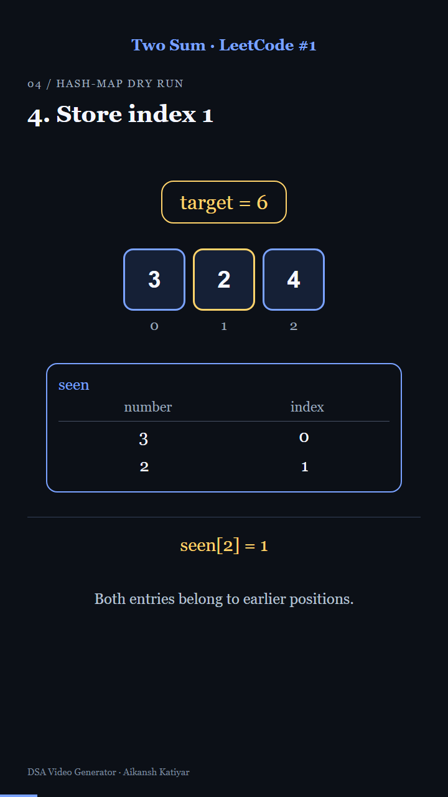

# DSA VIDEO GENERATOR plugin for codex

By **Aikansh Katiyar**. Turn an educational question into a narrated local video through Codex.

Ask: **"Make a Two Sum video: explain the problem, brute force with complexity, then the optimized method with a dry run and C++ code."**

The included skill researches the question using the host's browsing tools, authors a structured lesson, and runs Remotion plus local speech. The working examples are Two Sum and 0/1 Knapsack. English narration, no burned-in captions, portrait and landscape layouts, measured speech timing, transcript export, and speech caching are included.



## Compatibility and cost

Requires **Codex or ChatGPT Work with local shell/filesystem execution**, Node.js 22+ and npm. Tested on Windows with installed Microsoft voices. macOS `say`, Linux `espeak`, and optional Piper routes are included but not all independently tested. An ordinary ChatGPT web/mobile conversation with no execution environment cannot render videos just by downloading this repository.

There is no paid speech/rendering API or API key. Initial setup downloads npm packages, and Remotion may download a browser. The host's normal account usage and system requirements still apply. Remotion has its own license and organizational eligibility rules; see [third-party notices](THIRD_PARTY_NOTICES.md). This is a community project, not an OpenAI-endorsed or marketplace-approved product.

## Install as a third-party plugin

1. Download this repository's ZIP and extract it, or clone it:

   `git clone https://github.com/Aikansh-Official/DSA-VIDEO-GENERATOR-plugin-for-codex.git`
2. Open the cloned folder as a trusted local Codex project. It includes `.agents/plugins/marketplace.json` pointing to `plugins/dsa-video-generator`.
3. Restart the desktop app if the source does not appear. In the Plugins Directory select **Aikansh's DSA Videos**, then install **DSA Video Generator**. Availability depends on the client and workspace policy.
4. Start a local task, select/invoke the plugin, and ask it to make a video. The assistant will set up a separate video workspace on first use.

The installable plugin ZIP under Releases contains `plugin.json` at its root. It is also suitable for the official submission portal; downloading it does not automatically install it in every ChatGPT surface. Follow the [official local plugin instructions](https://developers.openai.com/plugins/build/plugins) for personal or team-wide discovery.

For discovery across your local projects, optionally run `node scripts/install-marketplace.mjs` from the cloned repository. It backs up an existing personal marketplace, preserves its other entries, and adds the version-pinned GitHub source. Restart the app, then install from your personal source. This changes local discovery only; it does not publish or submit anything to OpenAI.

## Direct smoke test without the plugin UI

From this repository:

```powershell
node plugins/dsa-video-generator/skills/create-dsa-video/scripts/setup.mjs --target "C:\Videos\dsa-lessons"
cd C:\Videos\dsa-lessons
node scripts/lab.mjs doctor
node scripts/lab.mjs render --lesson two-sum
```

Choose a new absolute workspace path. Setup refuses unrelated nonempty directories and preserves authored files in marked existing workspaces. Output: `out/two-sum.mp4` plus transcript and chapters. Repeating a render reuses unchanged narration.

To change voice, run `node scripts/lab.mjs voices`, then `node scripts/lab.mjs configure --voice "Microsoft David Desktop" --rate -1`. Silent mode is explicit, never the default.

## New lessons

Codex authors `lessons/<id>.json` using the bundled [format guide](plugins/dsa-video-generator/skills/create-dsa-video/references/lesson-format.md). The pipeline is a renderer and skill workflow, not a separate autonomous language model. New animations beyond the available layouts may require Codex to extend the generated project.

Supported domains are DSA, algorithms, CS, mathematics and physics. The validator rejects unsupported domain values and common disguised unrelated topics; it is not a semantic classifier, so the assistant also checks scope and factual correctness.

## Publication

Third-party distribution is through this GitHub repository and release ZIP. Official directory listing requires publisher identity verification, package scans and OpenAI approval. See [SUBMISSION.md](SUBMISSION.md) and [TESTING.md](TESTING.md). No official approval is claimed.

Report reproducible problems through [GitHub Issues](https://github.com/Aikansh-Official/DSA-VIDEO-GENERATOR-plugin-for-codex/issues). Do not include credentials or private lesson data.
